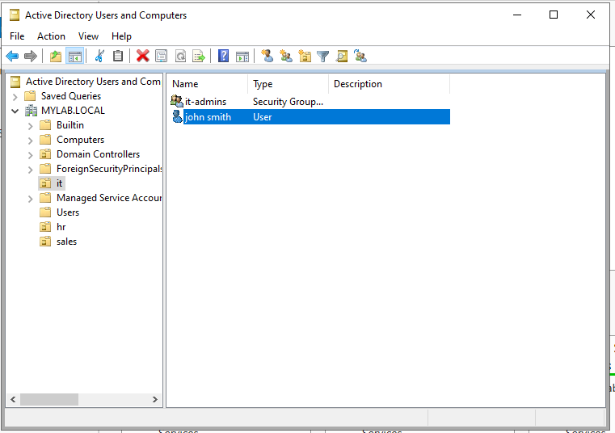
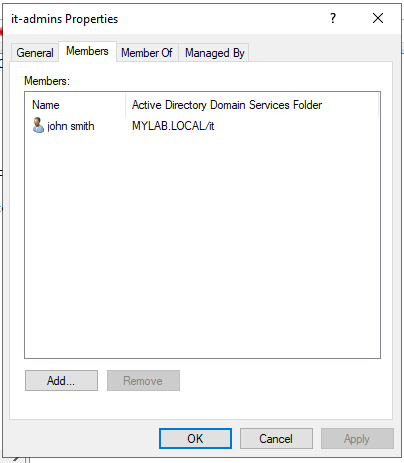
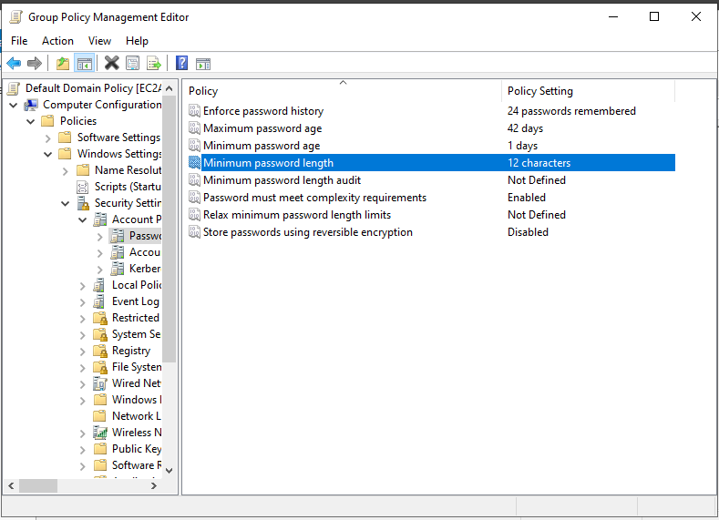
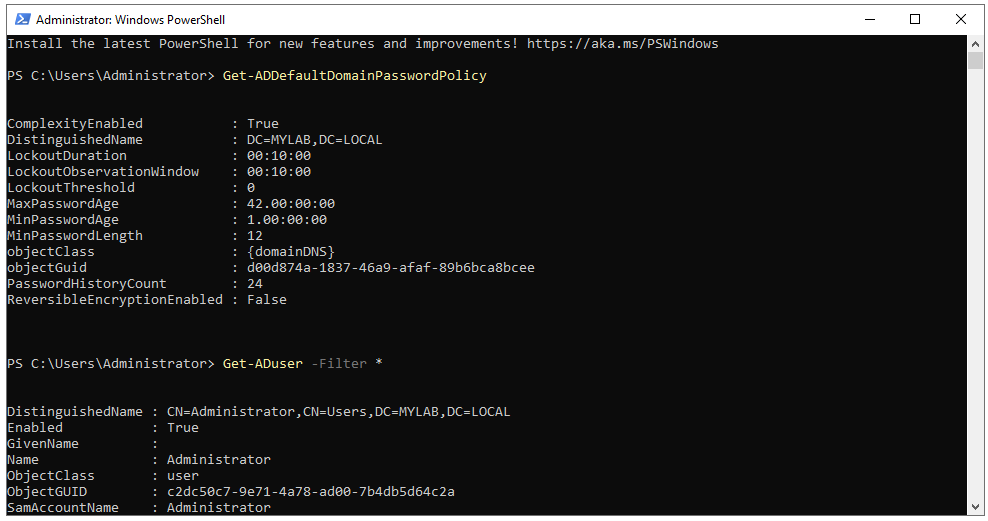
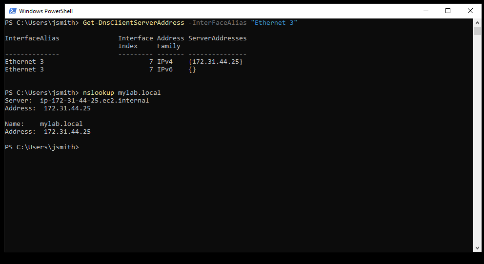
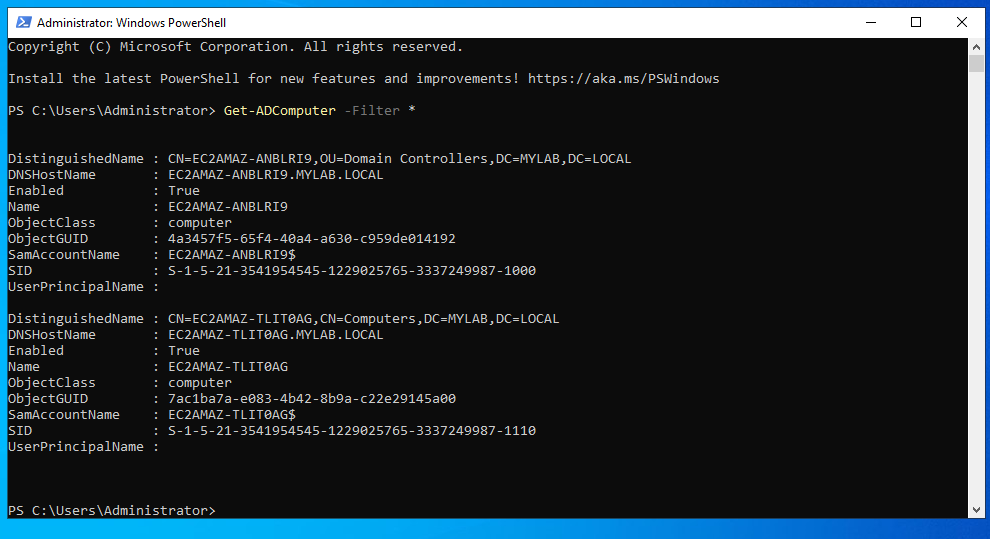
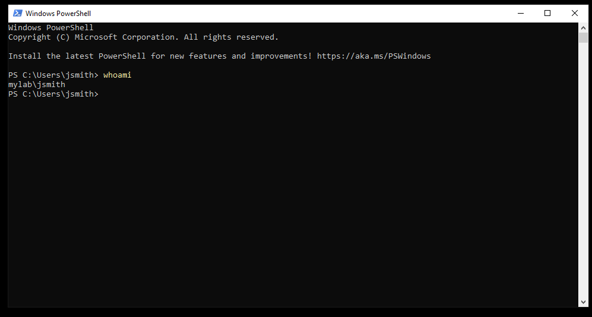

# Active Directory Lab on AWS

## Overview
Personal lab project simulating enterprise identity and access management using Windows Server Active Directory hosted on AWS EC2.

## Environment
- Windows Server 2022 running on an AWS EC2 instance
- Promoted to a Domain Controller hosting a new Active Directory forest (mylab.local)
- AWS account access managed through IAM; RDP restricted to a single IP via security group

## What I Did
- Deployed and configured a Windows Server instance on AWS EC2
- Installed Active Directory Domain Services and promoted the server to a Domain Controller
- Created organizational units (OUs) for IT, HR, and Sales
- Created user accounts and placed them in their departments
- Created a security group (IT-Admins) and added a user to demonstrate group-based access management
- Configured a Group Policy enforcing a 12-character minimum password length

## Troubleshooting
- After DC promotion, local admin login failed; resolved by signing in with the domain account (MYLAB\Administrator)
- Screenshot shortcuts were intercepted by the RDP session; used the Snipping Tool app instead
- File transfer from the server failed with clipboard and drive redirection disabled; uploaded directly to GitHub from the server

## Screenshots
**OU structure with user and security group**

**IT-Admins group membership**

**Password policy set to 12 characters**

**Powershell verification**

**Client dns config**

**Domain join**

**Domain user login**
